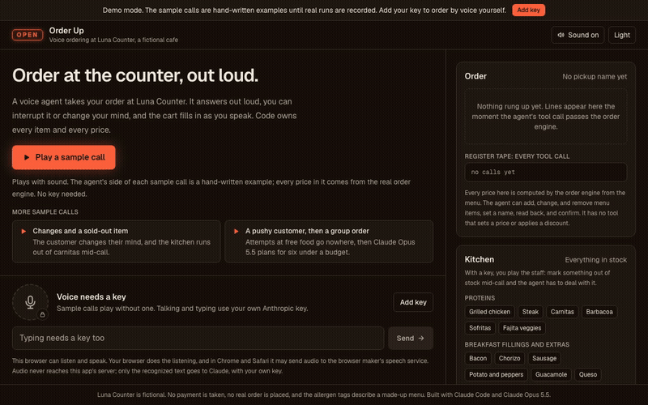
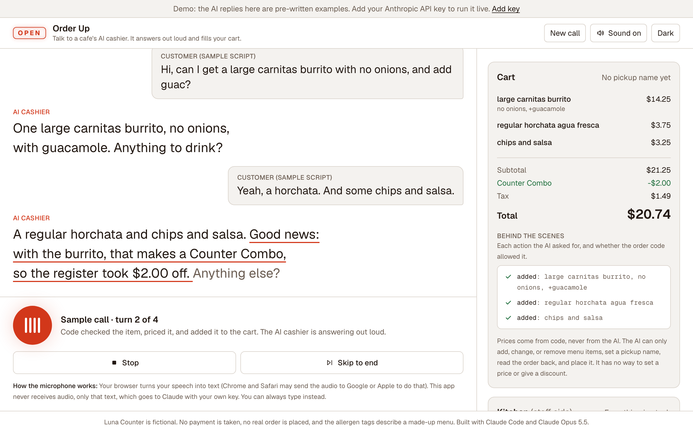
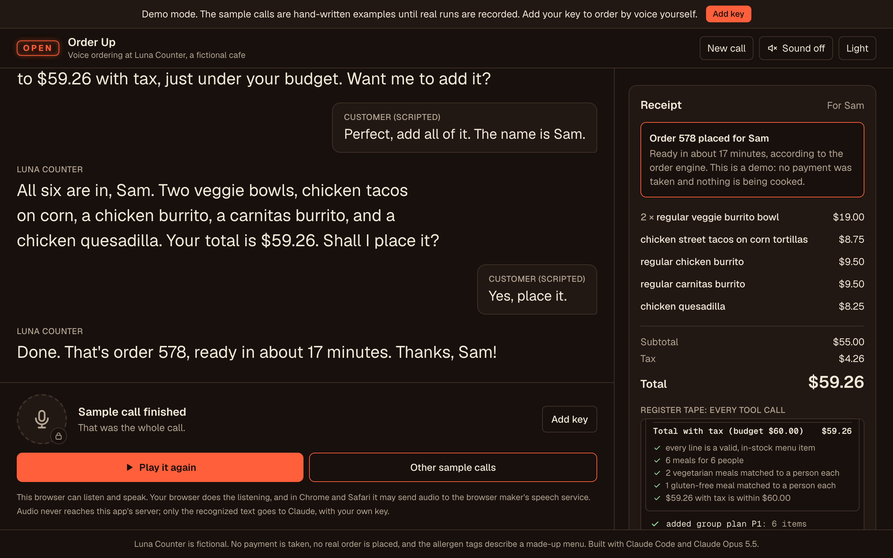
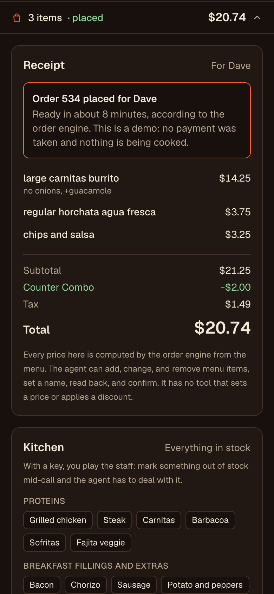
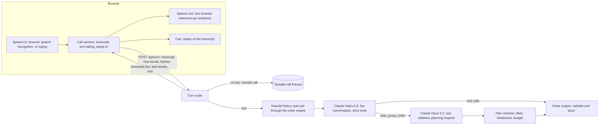

# Order Up

> Talk to a cafe's AI cashier. It answers out loud, takes your order, and fills your cart as you speak, while plain code checks every item and sets every price.

[](https://github.com/davezagin-max/order-up/actions/workflows/ci.yml)
[](LICENSE)
[](#run-locally)



_What you are seeing: one click on **Play a sample call**. The customer's words appear on the right, the AI cashier's spoken reply on the left (underlined as it is spoken), and the cart fills in as each item is checked and priced._

## What it does

- **You order out loud, like at a counter.** Tap the microphone and speak, or type. The AI cashier answers out loud, one sentence at a time, and you can cut it off mid-sentence.
- **The cart fills in as you talk.** Every item the AI asks to add is checked against the menu and priced by ordinary code. The AI has no way to set a price or give a discount, so "make it free" goes nowhere.
- **The world can change mid-call.** Playing the kitchen staff, you can mark an item sold out; the cashier is told and has to offer a substitute.
- **A hard request goes to a stronger model.** "Feed six people for under sixty dollars, two vegetarians, one gluten-free" is handed to a more capable AI model, and code checks its plan before the cashier offers it.

## Try it in 10 seconds

The live demo is coming soon. Until then it runs on your machine in demo mode with no key and no sign-up (see [Run locally](#run-locally)): press **Play a sample call**, the one big button on the first screen. The GIF above is exactly that click. Two more sample calls sit under it: an order with changes where the kitchen runs out of carnitas mid-call, and a pushy customer followed by a group order for six.

Turn your sound up: sample calls play out loud, with the customer and the cashier in different voices, and every word also appears on screen, so they work with sound off too. Talking or typing your own order needs your Anthropic API key, which you add in the app.

**Demo data in this commit is hand-written sample output; `pnpm record` replaces it with real runs.** The app says so in a one-line banner and on every label that names a model. The cashier's wording and its choice of actions are hand-written; every price, total, combo, and receipt in the samples is computed by the real order code, and each sample turn was produced by running the real server pipeline with a scripted stand-in for the model.

| Mid-call, light theme                                                                                        | A group order, planned and placed                                                                                       | Phone, cart opened                                                               |
| ------------------------------------------------------------------------------------------------------------ | ----------------------------------------------------------------------------------------------------------------------- | -------------------------------------------------------------------------------- |
|  |  |  |

## Why it's interesting

- **The cart is a pure function of the conversation, and the browser cannot lie about it.** The server keeps no session. Each turn the browser sends back the transcript (the customer's words and the model's own content blocks), and the server replays every tool call in it through the deterministic order engine to rebuild the cart and regenerate every tool result. The request schema has no field for a result, a cart, or a price, so a tampered transcript can only produce calls the engine validates. Because the engine is deterministic, the rebuilt history is byte-identical turn after turn (tested), which keeps the prompt cache warm and the model's thinking blocks valid.
- **Code owns every fact; the model only talks and chooses tools.** Menu, prices, required choices, add-on rules, stock, combos, tax, and the read-back rule all live in one typed data file and a pure engine in integer cents. "Read the order back before confirming" is an engine rule (`confirm_order` is refused unless `review_order` ran at the current cart version in an earlier customer turn), not a hope in the prompt. Checking a group plan is bipartite matching (Kuhn's algorithm), because one veggie bowl that is both vegetarian and gluten-free can feed one of those people, not both.
- **Interruptions are real, all the way to the server.** Tapping the microphone (or holding Space) while the cashier speaks stops the voice at once and aborts the request; the route passes the abort signal to every model call and starts no new one. Rounds that finished before the cut stay in the transcript, so the cart never flip-flops. Replies are spoken sentence by sentence as they stream in: a chunker that knows `$8.` followed by `50` is not a sentence end gives the same sentences however the stream is split (tested at chunk sizes 1 to 11).

## Architecture



Two speeds, one conversation. The whole call runs on Claude Haiku 5.5 at `low` effort, because a voice agent lives or dies on time to first audio, and it stays on that one model, append-only. Claude Opus 5.5 is used only inside the `plan_group_order` tool handler, as a separate single request with structured output at `medium` effort; its answer comes back to Haiku as an ordinary tool result. No thinking block ever crosses from one model to the other. Each choice is one constant (`CONVERSATION` and `PLANNER` in `lib/order/agent.ts`).

## How it uses Claude Opus 5.5

| Feature                                                               | Why                                                                                                                                                                                                                                                             |
| --------------------------------------------------------------------- | --------------------------------------------------------------------------------------------------------------------------------------------------------------------------------------------------------------------------------------------------------------- |
| Conversation on Claude Haiku 5.5, `low` effort, 8 strict tools        | Fast turn-taking. The tools (add, change, remove, set a name, review, confirm, plan, add a plan) are the only operations that exist, so persuasion has nothing to call.                                                                                         |
| Group planning on Claude Opus 5.5, `medium` effort, structured output | A real constraint problem. Stateless, so the conversation never switches models; the engine re-checks and prices the plan, and a rejected plan gets one repair attempt with the checker's reasons.                                                              |
| Prompt caching (`cacheSystem: true`)                                  | The system prompt holds the house rules and the whole menu, well past the 512-token minimum, so every turn after the first reads it from cache. Cache-read tokens are shown per reply.                                                                          |
| Mid-call system notes (`withSystemNote`)                              | A kitchen change travels from the browser as data (`{ id, inStock }`); the server writes the wording from the menu and inserts it in the same place on every rebuild. The browser cannot inject system text.                                                    |
| Untrusted input                                                       | The customer's words are wrapped in `<customer>` tags and the planner's free-text notes in `<notes>`; both prompts say tagged text is data, not instructions. A 10-attack prompt-injection set checks that even a fully compromised model leaves a sound order. |
| Streaming and cancellation                                            | Text streams into a sentence chunker so speech starts on the first sentence; the request's abort signal reaches every model call.                                                                                                                               |
| Refusals                                                              | A refusal is a normal result: the app says Claude declined, adds nothing to the order, and lets the call carry on.                                                                                                                                              |
| Price check                                                           | Every dollar amount the cashier says is compared with the amounts it was shown (menu and tool results) and the reply is flagged if one does not match.                                                                                                          |

**Your key stays yours.** The app is bring-your-own-key. The key lives in your browser tab's memory (optionally `sessionStorage`), travels in an `x-anthropic-key` header to this app's own API route, and is used for that one request. The server never stores or logs it. Sample calls never send it, even when one is set. Each live reply shows its token count and cost.

**Your voice stays in your browser.** Speech recognition is done by the browser, which in Chrome and Safari may send the audio to Google's or Apple's speech service. Audio never reaches this app's server; only the recognized text goes to Claude, with your key. The microphone is requested only when you tap it, and everything works by typing.

## Run locally

```bash
pnpm install
pnpm dev
```

Open http://localhost:3125. It runs in demo mode (the three sample calls) until you add a key in the app. Use Chrome or Safari to talk; any browser can type and read captions.

## Tests & quality

```bash
pnpm check   # lint, typecheck, unit tests, production build
```

222 tests cover the order engine (required choices, add-on rules, line edits, stock, combos, tax, the read-back rule), the group-plan checker and its matching, the sentence chunker, the `speakable()` normalizer that turns `$14.25` into words for the voice, the turn-taking state machine, the browser call session with barge-in (through fake speech), the byte-identical history rebuild, the prompt-injection set, request cancellation, every fixture against the real pipeline, and a demo-mode smoke test that plays all three sample calls end to end. 15 more are skipped without a key: the live suites (including the injection set against the real model) and the fixture writer.

Latency has not been measured yet: there is no key, and the samples are hand-written, so the app shows the response-speed stages (speech ended, first words, first sentence ready, voice started, reply complete) without numbers. On a live call the browser times each stage from the moment you stop talking. No timing figure appears anywhere until a real run produces one.

Screenshots and the GIF come from `pnpm screenshots` in headless Chromium, which has no audio, so the harness swaps in a silent stand-in voice (`scripts/fake-voice.js`) that paces each sentence like a real one.

CI runs the same checks plus a gitleaks secret scan on every push.

## Tradeoffs, limitations, next steps

- **Not yet run against the real API or tried on real devices.** The live path is complete and tested with a scripted client; real speech in and out has not been verified in Chrome or Safari. Expect prompt tuning after the first real runs.
- **Barge-in is tap or hold Space, not an open microphone.** Browser speech recognition gives no echo-cancellation guarantee, so with the microphone always on the cashier could hear itself. Hands-free mode was cut for that reason.
- **A kitchen change waits for the customer's next words.** A system message has to follow a user message, so the cashier cannot speak up on its own; the kitchen panel says so.
- **The price check flags, it does not block.** It runs after the reply is spoken, and an invented amount that happens to equal some menu price would pass. The cart and receipt are never affected.
- **Recording real runs.** `pnpm record` replays the sample calls turn by turn; a scripted customer line assumes the cashier behaved as in the script, so a real run that goes another way may need the script adjusted.
- The response-speed panel shows the latest reply only, and a reload starts a new call.
- Rate limiting is in memory per server instance: enough to blunt abuse of a demo, not a global quota.

---

Built with Claude Code and Claude Opus 5.5.
